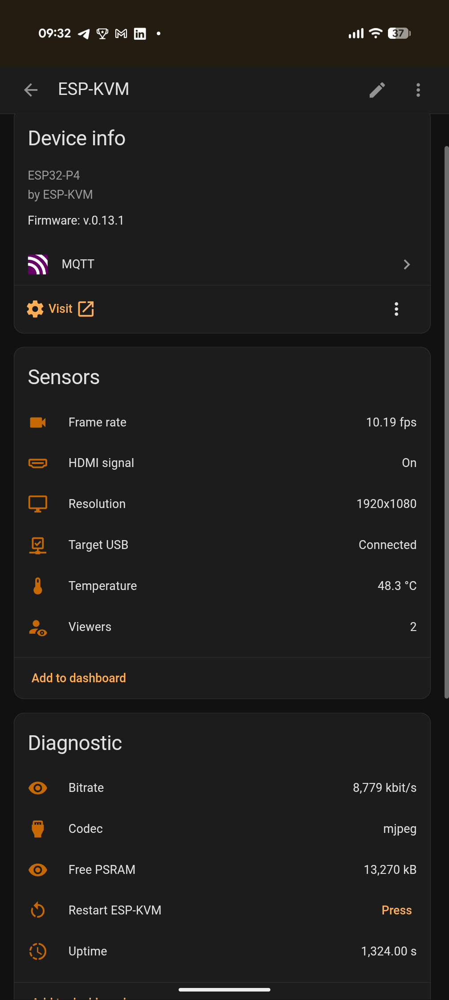
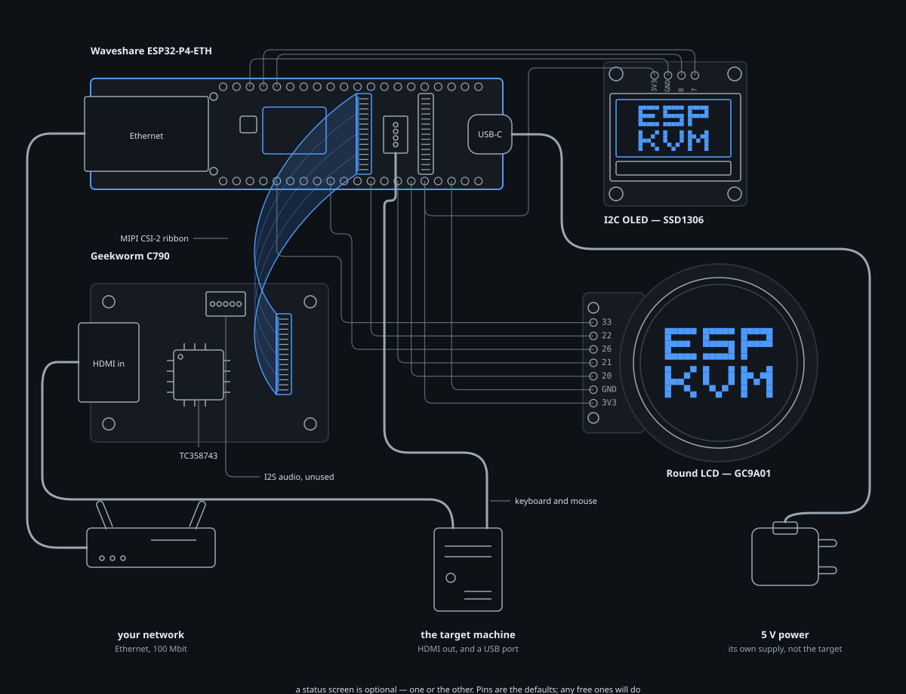

<p align="center">
  
</p>

# ESP-KVM

<p align="center">
  <a href="https://github.com/espkvm/espkvm/actions/workflows/firmware.yml"></a>
  <a href="https://github.com/espkvm/espkvm/releases/latest"></a>
  <a href="LICENSE"></a>
  
  
  <br>
  <a href="https://t.me/espkvm"></a>
  <a href="https://x.com/espkvm"></a>
  <a href="https://github.com/orgs/espkvm/discussions"></a>
  <a href="https://github.com/orgs/espkvm/discussions/65"></a>
</p>

Like remote desktop, except it does not run on the machine. A small board plugs
into that machine's HDMI output and a USB port, and serves its screen, keyboard
and mouse to a browser. So it still works where remote desktop cannot: a BIOS
screen, a boot menu, a kernel that will not come up, a machine with no operating
system on it at all.

That is an IP-KVM. This one is built from an ESP32-P4 and a Toshiba TC358743
HDMI-to-CSI bridge, and costs a fraction of a commercial KVM-over-IP.

New to the idea? [What an IP-KVM is, and why you might want one](https://espkvm.io/blog/what-an-ip-kvm-is/)
&mdash; what remote desktop cannot do, and where people actually use this.

<p align="center">
  <b><a href="https://espkvm.io/flash/">Flash a board from the browser &rarr;</a></b>
  &nbsp;&middot;&nbsp;
  <a href="https://demo.espkvm.io/">Try the console</a>
  &nbsp;&middot;&nbsp;
  <a href="#quick-start">Quick start</a>
</p>

<!-- The buttons sit below the description on purpose: a search engine quotes the
     first prose in this file, and that should say what the project is rather than
     ask for a star. The ask itself lives in Support, at the bottom. -->
<p align="center">
  <a href="https://github.com/espkvm/espkvm"></a>
  &nbsp;
  <a href="https://buymeacoffee.com/dexif"></a>
</p>


**From whatever you have to hand.** The console is a web page, so the machine
you drive the target from can be a laptop, a phone or a tablet - nothing to
install on either end. Touch gets a trackpad and an on-screen keyboard rather
than a shrunken desktop, the page can be installed from the browser to run
full-screen like an app, and where the link is too thin for video the screen
comes through as text.

<!-- TODO: one image of the console on a laptop, a phone and a tablet side by
     side. It is the fastest way to say "any device" and the table cannot. -->

> **Built on [jrowny/p4kvm](https://github.com/jrowny/p4kvm).** The hard part -
> bringing up the TC358743 and getting frames out of the ESP32-P4's CSI
> receiver - was solved there first, and this project would not exist without
> it. See [Credits](#credits).

## Status

Useful for what it does today, and honest about the rest.

| | |
|---|---|
| Video: follows the target's resolution, MJPEG and H.264 | works; H.264 needs HTTPS |
| Keyboard, mouse, media keys, pasting text in a layout | works |
| From a phone or a tablet | works; touch trackpad, pointer stick, pinch zoom and on-screen keyboard |
| Several viewers, one in control | works |
| Virtual media: boot the target from an image | works; from microSD or the device's flash |
| Recording, screenshots, dashcam, timelapse | works; on a microSD card |
| Reading a text screen as text, watching it for words | works; text modes only |
| Macros, runbooks, a scheduler | works |
| Notifications to Telegram or a webhook | works |
| Power, reset and Wake-on-LAN | works; power needs an optocoupler or a relay |
| HDMI-CEC remote | works; on TC358743 boards |
| A gamepad for a console | works on a Switch |
| Device profiles: pointer, gamepad and video settings for each target | new, the device picks one from HDMI-CEC or the USB guess |
| Screen areas: react when a part of the screen changes, stops changing, matches a saved picture or turns a colour | new |
| The target's serial console, and its log over the network | works |
| HTTPS, your own certificate, Let's Encrypt over Tailscale | works |
| Login, two-factor sign-in, reset by a button | works |
| Wi-Fi, a setup hotspot, Ethernet with Wi-Fi as the backup | works; on boards with a Wi-Fi chip |
| Tailscale or WireGuard | works; off by default |
| Home Assistant over MQTT | works; off by default |
| Updates over the network, with rollback | works |
| A small status display, a battery-backed clock | works; optional |
| HDMI audio, in the console and in recordings | new; on TC358743 boards, three wires to the P4 |

Every row in detail: [docs/HOW-IT-WORKS.md](docs/HOW-IT-WORKS.md#what-works-in-detail).

What is coming next is in the [roadmap](ROADMAP.md).

<p align="center">
  
</p>
<p align="center"><em>The device in Home Assistant &mdash; every value reported live over MQTT, discovered automatically.</em></p>

**Do not put this on the public internet.** It has a login, two-factor sign-in
and TLS, and has had a security review of my own but not an external one. Secure
boot and flash encryption are off, and update images are not signed. Keep it on
a network you trust, or reach it over the Tailscale or WireGuard built into it
([docs/SETUP.md](docs/SETUP.md#reaching-it-from-outside-tailscale-or-wireguard)).

## Hardware

An ESP32-P4 board does the work, a TC358743 capture board turns the target's
HDMI into a stream the P4 can read, and a camera ribbon joins the two. That is
all it takes; an optocoupler for the power button and a small status screen
are optional.



**The capture board:** a [Geekworm C790](https://wiki.geekworm.com/C790) or a
[Waveshare HDMI to CSI Adapter](https://www.waveshare.com/wiki/HDMI_to_CSI_Adapter).
The M5Stack Unit PoE-P4 takes its own [Add-on Display In](https://shop.m5stack.com/products/add-on-display-in-for-poe-p4-lt6911d) instead.

**The ESP32-P4 board**, one of these:

| Board | Network | Chip revision | |
|---|---|---|---|
| [Waveshare ESP32-P4-ETH](https://espkvm.io/boards/p4-eth/) | Ethernet | 1.x or 3.x | tested; the default |
| [Espressif ESP32-P4 Function EV](https://espkvm.io/boards/funcev/) | Ethernet, Wi-Fi | 1.x or 3.x | tested |
| [Waveshare ESP32-P4-NANO](https://espkvm.io/boards/p4-nano/) | Ethernet, Wi-Fi | 1.x or 3.x | tested |
| [Guition ESP32-P4-M3-Dev](https://espkvm.io/boards/p4-guition/) | Ethernet, Wi-Fi | 1.x or 3.x | tested |
| [Waveshare ESP32-P4-WIFI6-POE-ETH](https://espkvm.io/boards/p4-poe/) | Ethernet with PoE, Wi-Fi | 1.x or 3.x | tested |
| [Waveshare ESP32-P4-WIFI6](https://espkvm.io/boards/p4-wifi6/) | Wi-Fi only | 1.x or 3.x | tested |
| [Waveshare ESP32-P4-WIFI6-DEV-KIT](https://espkvm.io/boards/p4-wifi6-devkit/) | Ethernet with PoE, Wi-Fi | 1.x or 3.x | tested |
| [DFRobot FireBeetle 2 ESP32-P4](https://espkvm.io/boards/firebeetle2-p4/) | Wi-Fi only | 1.x | tested |
| [M5Stack Unit PoE-P4](https://espkvm.io/boards/m5-poe-p4/) | Ethernet with PoE | 1.x | tested |
| [Waveshare ESP32-P4-NANO-WIFI6-DB](https://espkvm.io/boards/p4-nano-wifi6-db/) | Ethernet, 5 GHz Wi-Fi | 3.x | tested |
| [Waveshare ESP32-P4-Module-DEV-KIT](https://espkvm.io/boards/p4-module-devkit/) | Ethernet, Wi-Fi | 1.x or 3.x | untested |
| [Espressif ESP32-P4X-C5-Function-EV](https://espkvm.io/boards/funcev-c5/) | Ethernet, 5 GHz Wi-Fi | 3.x | untested |
| [Waveshare ESP32-P4-WIFI6-DB](https://espkvm.io/boards/p4-wifi6-db/) | 5 GHz Wi-Fi only | 3.x | tested |
| [VIEWE ESP32-P4-Pi](https://espkvm.io/boards/viewe-p4-pi/) | Ethernet, Wi-Fi | 1.x | untested |
| [M5Stack Unit PoE-P4X](https://espkvm.io/boards/m5-poe-p4x/) | Ethernet with PoE | 3.x | untested |

"Untested" means the image is built from the vendor's schematic and nobody has
run it yet; if you have one, say how it went. Another P4 board? [Every ESP32-P4
board I have looked at](https://espkvm.io/boards/all/) says whether it can work. Rev 3.x silicon runs H.264 three
times faster at 1080p, and it takes its own image: the boot log prints the
revision, and so does the chip, **ESP32-P4NRW32X** with an X being rev 3.x.

To choose between them: [compare the boards](https://espkvm.io/boards/compare/).
Photos, cables, which port goes to the target, cases and status screens are in
[docs/BOARDS.md](docs/BOARDS.md), with what rules a board out if yours is not
listed.

## Quick start

1. **Flash it.** From the browser, in Chrome or Edge:
   [espkvm.io/flash](https://espkvm.io/flash/). Or take your board's
   `espkvm-<version>-<board>-merged.bin` from the
   [releases](https://github.com/espkvm/espkvm/releases) and write it at 0x0:

   ```sh
   esptool --chip esp32p4 -b 921600 write-flash 0x0 espkvm-<version>-<board>-merged.bin
   ```

   Drivers and serial-port notes: [docs/FLASHING.md](docs/FLASHING.md).
2. **Connect it:** the network, HDMI from the target, and the board's USB OTG
   port to the target. Which port that is depends on the board - on the
   P4-ETH it is the MX1.25 header, not the USB-C ([cables](docs/BOARDS.md#cables)).
3. **Open https://espkvm.local/** and sign in as **admin / admin**; it asks for a
   new password first. A board with Wi-Fi and no cable opens a hotspot,
   **ESP-KVM-xxxx**, with the console at `http://192.168.4.1/`.
4. **Trust the device's CA** (Settings &rarr; Security &rarr; Download CA
   certificate, or `http://espkvm.local/cert.pem`) as a trusted authority. The
   picture works without it, but the keyboard, the mouse and H.264 need a page
   the browser trusts.

Certificates of your own, Let's Encrypt over Tailscale, IPv6, the hotspot and
updates: [docs/SETUP.md](docs/SETUP.md).

## If it does not work

The usual causes - the USB lead in the wrong port, an untrusted certificate, a
target that looks for a monitor too early, a reboot to explain - and how to tell
them apart are in [docs/TROUBLESHOOTING.md](docs/TROUBLESHOOTING.md). Still
stuck: [Discussions](https://github.com/orgs/espkvm/discussions), with the board,
the capture board and the log from Diagnostics.

## Building from source

The web console lives in a submodule ([espkvm/console](https://github.com/espkvm/console)),
so clone with `--recursive` (or run `git submodule update --init` in an existing
clone). Without git, take `espkvm-<version>-source.tar.gz` from a release (from
0.56.3 on): GitHub's own "Source code" archives leave the submodules out.

```sh
git clone --recursive https://github.com/espkvm/espkvm
tools/install-idf.sh                          # ESP-IDF 6.1, once
. tools/env.sh
cd web && npm ci && npm run build && cd ..    # the console is embedded in the firmware
idf.py build
idf.py -p /dev/ttyACM0 -b 921600 flash
```

There is no `menuconfig` step for the default board: everything it needs is in
`sdkconfig.defaults`. To build for another board, apply its overlay - see
[boards/](boards/README.md).

The console can also be developed against a simulated device, with no hardware
attached at all:

```sh
cd web && npm run dev:mock
```

### Tests

```sh
tools/test.sh          # all of it: the host C and the console, in seconds
tools/test.sh host     # just the C
tools/test.sh web      # just the console
```

## How it works


The P4's hardware JPEG and H.264 encoders compress the picture, and one USB
port presents a keyboard, two pointers and a disk to the target. At 1080p,
MJPEG runs at about 20 fps on any board; H.264 at 25-27 fps on rev 3.x and
about 7 on rev 1.x. From moving the mouse to seeing it: about 60 ms on rev 3.x. The console is one gzipped file of about 70 KB, with nothing
fetched from outside.

Video, input, recording, virtual media, reading the screen, security and
updates, in detail: [docs/HOW-IT-WORKS.md](docs/HOW-IT-WORKS.md).

## API

Everything the console does is available over HTTP: settings, video and the
screen as text, recording, virtual media, power, HDMI-CEC, the target's serial
console, and, behind a switch in Settings &rarr; Security, the keyboard and
pointer. The full list, how to sign in, and the WebSocket protocol are in
[docs/API.md](docs/API.md).

To hand it to an AI agent there is a skill,
[espkvm/skills](https://github.com/espkvm/skills), and an MCP server,
[espkvm/mcp](https://github.com/espkvm/mcp).

### Built by other people

- **[guacamole-espkvm](https://github.com/Crisspii/guacamole-espkvm)** by
  [Crisspii](https://github.com/Crisspii) - an Apache Guacamole protocol plugin,
  so several devices sit in one Guacamole as ordinary connections, with the
  credentials held on the server. It speaks this device's own protocol rather
  than wrapping a browser: H.264 and MJPEG, keyboard, pointer and virtual media.
  Experimental, v0.1.0, tested against Guacamole 1.6.0.

## Repository layout

```
components/
  tc358743/       HDMI bridge driver, EDID profiles
  video_pipeline/ CSI capture, MJPEG and H.264 codecs, published frame store
  kvm_hid/        composite USB HID
  kvm_storage/    microSD and on-flash rescue image, virtual media
  kvm_config/     settings registry and capability registry
  kvm_screentext/ reading a text-mode screen back as characters
  kvm_record/     recording to the card, the dashcam, the timelapse, MP4 remux,
                  screenshots, and the keystroke subtitles
  kvm_runbook/    runbooks: scripted keys and screen waits, run on the device
  kvm_sched/      scheduler: cron lines that fire actions on the device
  kvm_notify/     push notifications to Telegram and a webhook
  kvm_web/        HTTP/HTTPS server, REST API, WebSockets, TLS identity
  kvm_webrtc/     H.264 to the browser over WebRTC (ICE-lite, DTLS-SRTP)
  kvm_net/        Ethernet, WiFi (station/AP + rescue hotspot, captive portal),
                  IPv6, mDNS, Wake-on-LAN, and the VPN clients (WireGuard,
                  or Tailscale through third_party/microlink)
  kvm_atx/        power and reset buttons, power-LED sensing
  kvm_cec/        HDMI-CEC: acting as a TV, remote keys, standby and wake
  kvm_display/    the optional status screen (I2C OLED, round SPI LCD)
  kvm_log/        the log kept in RTC memory across a restart
  kvm_mqtt/       Home Assistant discovery and state
  kvm_board/      pin map
  esp_tinyusb/    vendored, patched for the mass-storage path
third_party/
  microlink/      submodule: the native Tailscale client
web/              the console (Vue 3 + TypeScript + Vite), a submodule
boards/           per-board build overlays - Function EV, NANO, Guition, PoE,
                  and the rev 3.x twins
tools/            toolchain setup, EDID generation, hardware probes
docs/             what the hardware actually does
```

## In the media

- [Hackaday](https://hackaday.com/2026/07/30/a-capable-kvm-built-with-the-esp32/) - *A Capable KVM Built With The ESP32*
- [CNX Software](https://www.cnx-software.com/2026/07/30/esp-kvm-an-open-source-ip-kvm-solution-based-on-esp32-p4-risc-v-mcu/) - *ESP-KVM - An open-source IP KVM solution based on ESP32-P4 RISC-V MCU*
- [Circuit Rocks](https://blog.circuit.rocks/esp-kvm-turns-an-esp32-p4-into-a-45-open-source-ip-kvm) - *ESP-KVM Turns an ESP32-P4 Into a $45 Open-Source IP KVM*
- [Open Source For You](https://www.opensourceforu.com/2026/07/microcontroller-enables-remote-device-access/) - *Microcontroller Enables Remote Device Access*
- [Solid State Bytes](https://ssbytes.org/p/a-raspberry-pi-that-boots-straight-into-ai-an-esp32-p4-kvm-and-more) - *A Raspberry Pi That Boots Straight Into AI, an ESP32-P4 KVM, and More*
- [LAB1612](https://1612.it/posts/esp-kvm-ip-kvm-esp32-p4/) - *ESP-KVM: un IP-KVM open source con un solo ESP32-P4, alternativa economica a PiKVM e JetKVM* (in Italian; a comparison against PiKVM and JetKVM, fair about what is still missing here - no security review, and one pair of hands)
- [SMZDM](https://post.smzdm.com/p/a70dq2ql/) - *一周两条GBA满帧视频、一块59元新板：ESP32-P4终于"能玩了"，但上手前先看这三个问题* (in Chinese; ESP-KVM is one of three ESP32-P4 projects it weighs up, and it repeats this project's own advice to keep the device on a network you trust)
- [EdigE](http://edige.xyz/news/esp32-p4-hdmi-ip-kvm) - *An ESP32-P4 turned into a real IP-KVM with HDMI, H.264, USB HID and boot images* (in Russian, and it goes into the capture path and the frame budget rather than only the feature list)
- [LearningBot](https://learningbot.tech/newsletter/every-ai-output-in-europe-needs-a-receipt-starting-today/) - *Build of the Week* (a newsletter about the EU AI Act's transparency rules picks ESP-KVM as its build, and likes that one chip has to be a USB peripheral and a capture pipeline at once)
- [RISC-V International](https://www.linkedin.com/pulse/week-risc-v-july-31-2026-risc-v-international-zzxze) - *This Week in RISC-V* (July 31, 2026)
- [私人定制 Blog](https://jinbel.cn/post/1487.html) - *GitHub 开源 ESP-KVM：$45 把 ESP32-P4 变成 IP 远程控制卡* (in Chinese)
- [log8.kr](https://log8.kr/library/esp32-ip-kvm-out-of-band-recovery-2026/) - *ESP32 IP-KVM 홈랩 원격 복구 설계* (in Korean; a recovery-and-security checklist built around the device rather than a review of it)
- [BearBlogtech](https://bearblogtech.ca/espkvm.html) - *ESPKVM an Open Source Kvm with IP and an ESp32* (a build log written after the author's own datacentre KVM died)

Also on video in [5 Minutos de Miercoles #22](https://youtu.be/nw-8a1GmJLE?t=342)
(Spanish, with dubbed tracks), and the origin story on
[Habr](https://habr.com/ru/articles/1069442/) (Russian). Waveshare links it from
its [HDMI to CSI adapter wiki](https://www.waveshare.com/wiki/HDMI_to_CSI_Adapter).

## Star history

[](https://www.star-history.com/?repos=espkvm%2Fespkvm&type=date&legend=bottom-right)

## Credits

This project exists because of **Jonathan Rowny** and his
**[p4kvm](https://github.com/jrowny/p4kvm)** proof of concept. He was the one
who got an ESP32-P4 to pull frames off a TC358743 at all, and put it out in
the open with a working [demonstration](https://youtu.be/f21f6RnW5Yc) for
anyone to build on. This is that thing built on. Start with his repository and
his video; everything here stands on them.

The history was not carried over into this repository, so the debt is recorded
here instead, and it is a real one. Two pieces of that work represent reverse
engineering that no datasheet would have handed us:

- **the TC358743 bring-up sequence** - PLL dividers, MIPI timing counters, the
  order in which hotplug and the CSI transmitter have to be brought up. One
  wrong register and the result is a black screen with nothing to debug;
- **direct programming of the ESP32-P4's `MIPI_CSI_BRIDGE` registers**, which
  the `esp_cam_ctlr` API does not expose. Espressif's examples target ordinary
  camera sensors, not an HDMI bridge.

Both still carry this firmware. The layers above them - HTTP, WebSockets, HID,
the interface - were rewritten, and the aim is different: p4kvm is explicit
about being a proof of concept, while this tries to be a KVM you would leave
installed. Thank you, Jonathan, for publishing it.

The register sequence also follows the Linux kernel driver
`drivers/media/i2c/tc358743.c` and Toshiba's TC358743XBG functional
specification.

The interface icons follow the Feather and Lucide conventions closely enough
that those sets deserve the credit; see [NOTICE](NOTICE).

The original Xbox gamepad mode, and a check on the capture size at boot, come
from **ZacharyLeahan**'s [fork](https://github.com/ZacharyLeahan/espkvm), which
runs ESP-KVM on an original Xbox. He worked out the XID protocol on a real
console; the descriptor bytes and the vendor requests here are his.

A 3D-printed enclosure for the original parts is published by jrowny on
[MakerWorld](https://makerworld.com/en/models/2961981-esp32-p4-ip-kvm-enclosure).

## Support

ESP-KVM is free and open source. The easiest way to help is to
[star it on GitHub](https://github.com/espkvm/espkvm) - it costs nothing and helps
others find the project. If it saved you a trip to a dead machine and you want to say
thanks, you can [buy me a coffee](https://buymeacoffee.com/dexif) - entirely optional,
and contributions of code, issues and ideas are just as welcome.

Running one? Tell me what works for you and what gets in your way in the
[feedback thread](https://github.com/orgs/espkvm/discussions/65), and how many you
run in the [poll](https://github.com/orgs/espkvm/discussions/60). The firmware
itself sends nothing. If you turn on the update check, your browser also reports
a random id of the device, its board and its version once a day, so I can count
the devices in use (see [SETUP](docs/SETUP.md)).
Questions, ideas and things people built go in
[Discussions](https://github.com/orgs/espkvm/discussions).

Release notes and work in progress go out on
[Telegram](https://t.me/espkvm) and [X](https://x.com/espkvm); the short clips of
features running are on [YouTube](https://youtube.com/@espkvm).

## Licence

Apache-2.0, the same licence p4kvm and ESP-IDF use. See [LICENSE](LICENSE) for
the text and [NOTICE](NOTICE) for the attribution it requires.

One licence for the whole repository, deliberately: the files inherited from
p4kvm have to stay Apache-2.0 whatever the rest does, and a split would mean
every new file needs someone to remember which side it falls on. Apache also
carries an explicit patent grant from contributors, which MIT does not - worth
having on a hardware project, though it says nothing about third-party patents:
H.264 is encumbered no matter what licence sits on this code.
