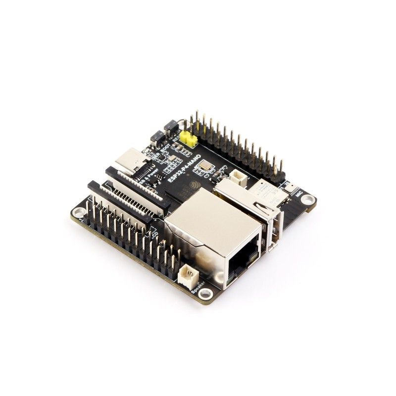
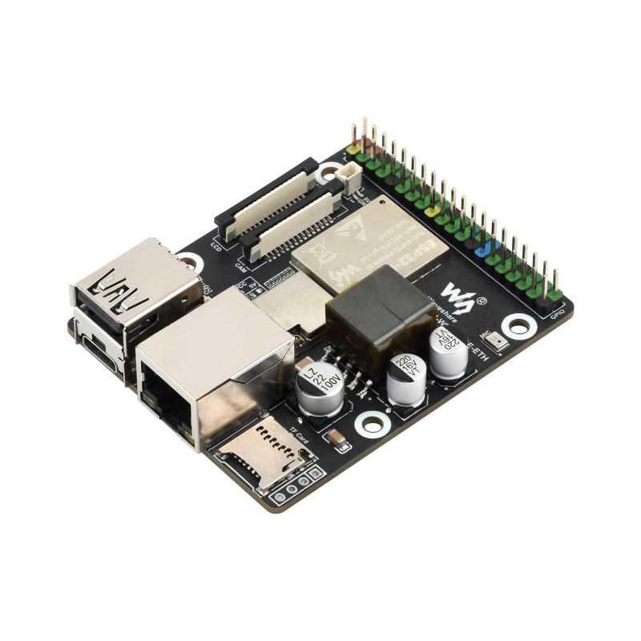
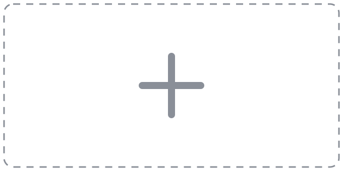
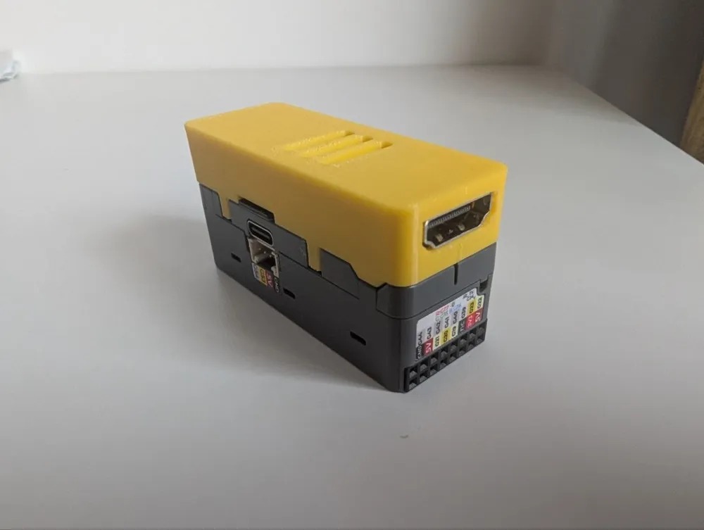

# Boards and parts

Every board ESP-KVM runs on, the capture boards, and the optional extras. The
same boards, side by side, are on [espkvm.io/boards/compare](https://espkvm.io/boards/compare/).

An ESP32-P4 board does the work, a TC358743 bridge turns the target's HDMI into a
stream it can read, and a CSI ribbon joins the two. The C790 has both kinds of
camera connector - a 15-pin 1.0 mm one (the Raspberry Pi 4 kind) and a 22-pin
0.5 mm one (the Pi 5 / Zero kind) - and comes with a ribbon for each, so use the
one that fits the board. An optocoupler module
is an optional add-on for ATX power control.

## The device — pick one ESP32-P4 board

<table>
<tr>
<td width="50%"></td>
<td width="50%"></td>
</tr>
<tr>
<td valign="top">

**[Waveshare ESP32-P4-ETH](https://www.waveshare.com/esp32-p4-eth.htm)** &mdash; chip rev v1.3, the default

ESP32-P4 with 32 MB PSRAM, 32 MB flash, 100M Ethernet, a **22-pin 0.5 mm** CSI
connector (the Pi 5 / Zero kind - the C790's rear connector and its 22-pin
ribbon), USB 2.0 OTG HS and a microSD slot. Built by plain `idf.py build`.

</td>
<td valign="top">

**[Espressif ESP32-P4 Function EV Board](https://docs.espressif.com/projects/esp-dev-kits/en/latest/esp32p4/esp32-p4x-function-ev-board/user_guide.html)** &mdash; chip rev v3.2 here; earlier units are rev 1.x

Espressif's own board, with an onboard ESP32-C6 &mdash; so it also does WiFi
(station, access point, and the rescue hotspot). Its own build target
(`boards/funcev_p4.defaults`), and the [browser flasher](https://espkvm.io/flash/)
offers it directly. The rev 3.2 silicon feeds native YUV422 straight into the
H.264 and JPEG encoders (no PPA colour-convert pass), which frees ~4 MB of PSRAM
for a deeper capture ring and lifts 1080p to a little over 20 fps.

</td>
</tr>
</table>

Any other ESP32-P4 board with Ethernet and the same CSI connector can run it too
&mdash; the pins are set in [menuconfig](PORTING.md), not in the code.

## What rules a board out

Being an ESP32-P4 board is not enough. It needs
**32 MB of PSRAM** (the frame buffers are allocated once for the largest mode:
12.5 MB at 1080p on rev 3.x, 11.9 MB on rev <3.0, before the H.264 encoder asks
for its reference frame - 8 MB cannot hold them), **16 MB of flash** (two OTA
slots and the rescue image), a **camera connector the bridge can reach** (two
CSI-2 lanes, plus 3.3 V and I2C on it or somewhere to wire them from - some
boards bring only 1.8/2.8 V sensor rails and shift the I2C down with them),
**USB OTG-HS on a port or a header** rather than only on an edge connector, and
**a way onto the network** - an Ethernet PHY or an onboard ESP32-C6. The
[LILYGO T-Halow P4](https://lilygo.cc/en-us/products/t-halow-p4) is the worked
example of a board that looks right and misses four of the five: 8 MB PSRAM,
RMII and USB OTG only on its M.2 edge, and no 3.3 V on its camera FPC.

## The chip revision

Below revision 3.0 several peripherals behave
differently and rev <3.0 and >=3.0 are mutually exclusive build targets. On rev
<3.0 the colour conversion the H.264 encoder needs goes through the PPA; on rev
>=3.0 the encoders take the captured YUV422 (or RGB) directly and the PPA is not
used. The default build (`sdkconfig.defaults`) selects the pre-3.0 family, so a
v1.x part builds and runs as shipped; a rev 3.x board is built from its own
overlay (see [boards/](../boards/README.md)). What was measured on the boards in
front of us, including the documented claims that turned out to be false, is
written down in [HARDWARE-NOTES.md](HARDWARE-NOTES.md).

To tell the revision before flashing, read the chip: **ESP32-P4NRW32X**, with
an X at the end, is rev 3.x; **ESP32-P4NRW32** without it is rev 1.x. On the
chip itself the second character of the manufacturing code is the revision: C
for v1.0, E for v1.3, F / G / H for v3.0 / v3.1 / v3.2
([Espressif's table](https://docs.espressif.com/projects/esp-chip-errata/en/latest/esp32p4/01-chip-identification/index.html)).
The product code of the board does not tell - the same board ships with either.
The number in the part name is the PSRAM in megabytes: an **NRW16** or
**NRW16X** chip has 16 MB, less than the first point above asks for, and has
not been tried.

## More boards, run on real hardware

Each of these has had this firmware on it, on someone's bench. The first four
carry an ESP32-P4, a MIPI-CSI connector, USB OTG-HS and an onboard ESP32-C6; the
M5Stack unit is the exception on every count but the P4 itself - no
WiFi, and its capture arrives on a flat cable of its own. Most units tested were
pre-3.0 silicon, so the overlays build for that by default and a rev 3.x unit
takes the `-rev3` image instead.

<table>
<tr>
<td width="50%"></td>
<td width="50%"></td>
</tr>
<tr>
<td valign="top">

**[Waveshare ESP32-P4-NANO](https://www.waveshare.com/esp32-p4-nano.htm)**

Same IP101 Ethernet and onboard ESP32-C6 as the boards above; 32 MB PSRAM, 16 MB
flash. Contributors confirmed capture, USB and Ethernet on both revisions, and
WiFi on rev 3.1. Its OTG-HS port is a USB-A socket that drives its own 5 V, so
the lead to the target must be an A-to-A cable with the 5 V wire cut. Build
overlay: `boards/nano_p4.defaults`, or `boards/nano_p4_rev3.defaults` on rev 3.x
silicon - it ships as either revision under one product code.

</td>
<td valign="top">

**Guition ESP32-P4-M3-Dev (JC-ESP32P4-M3)**

A display board (4.3&Prime; MIPI-DSI touch, unused by the KVM) that also carries
Ethernet and an ESP32-C6; 32 MB PSRAM, 16 MB flash. Confirmed by a contributor.
Two USB-C ports - the target goes on the OTG-HS one. The capture board's ribbon
goes into **J3**, not J2 ([#61](https://github.com/espkvm/espkvm/issues/61)). Build overlay:
`boards/guition_p4.defaults`, or `boards/guition_p4_rev3.defaults`.

</td>
</tr>
</table>

<table>
<tr>
<td width="50%"></td>
<td width="50%"></td>
</tr>
<tr>
<td valign="top">

**[Waveshare ESP32-P4-WIFI6-POE-ETH](https://www.waveshare.com/esp32-p4-wifi6-poe-eth.htm)**

The first supported board that takes **PoE**, so a KVM in a rack needs one cable
instead of two. Same IP101 Ethernet, same microSD wiring and the same ESP32-C6
over SDIO as the boards above; 32 MB PSRAM, 32 MB flash, and a full-size USB-A
port for the target. Confirmed by [@deltorek112](https://github.com/deltorek112)
on rev 3.x silicon with the `p4-poe-rev3` image: 1080p over H.264 at 23 fps,
through a Waveshare HDMI to CSI Adapter
([issue #51](https://github.com/espkvm/espkvm/issues/51)). Build overlay:
`boards/poe_p4.defaults`, or `boards/poe_p4_rev3.defaults`.

Waveshare said in August 2026 that these ship rev 1.3, but the one tested was
rev 3.x - **check the boot log before flashing**: it prints `chip revision: v3.1` (or v1.3), and a
rev 3.x board wants the `-rev3` build. The pre-3.0 image has not been run on
this board yet.

</td>
<td valign="top">

**[Waveshare ESP32-P4-WIFI6](https://www.waveshare.com/esp32-p4-wifi6.htm)**

The PoE board without its wired half, contributed by
[@nwomn](https://github.com/nwomn), who has one: capture through the C790 and the
USB keyboard and mouse both work, and the header is checked against the board.
32 MB PSRAM, 32 MB flash. Build overlay: `boards/waveshare_p4_wifi6.defaults`.

WiFi is the only link it has, and it used to stall: the board pulls its SDIO
lines up through 51k where Espressif ask for 10k, which lost the co-processor's
data-ready interrupt. Since 0.41.1 the chip's own pull-ups are on for this board
and it holds. That is one board and one tester -
[issue #27](https://github.com/espkvm/espkvm/issues/27) if yours differs. USB
OTG-HS is on an **MX1.25 4-pin header**, so the target needs an MX1.25-to-USB-A
cable.

</td>
</tr>
</table>

<table>
<tr>
<td width="50%"></td>
<td width="50%"></td>
</tr>
<tr>
<td valign="top">

**[M5Stack Unit PoE-P4](https://docs.m5stack.com/en/unit/Unit_PoE-P4)** &mdash;
*the smallest complete one*

The smallest of the lot, and the only one where the capture board is not a C790:
M5Stack's own **[Add-on Display In](https://shop.m5stack.com/products/add-on-display-in-for-poe-p4-lt6911d)**
plugs onto its 24-pin FPC and brings a microSD slot with it. 32 MB PSRAM, 16 MB
flash, the same IP101 Ethernet on the same GPIOs as the P4-ETH, 802.3at PoE.

The add-on's bridge is a **Lontium LT6911D**, not a TC358743, and it works.
Measured on hardware: at 1280&times;720 about 22 fps over MJPEG and 17 over
H.264; at 1920&times;1080 about 9 and 6. 720p is the mode to give it - the
conversion its bridge needs costs four times less there. One thing about it is unlike every other board here: its reset line is
active high, the opposite way round from a TC358743. Otherwise it behaves - it
measures the source's mode itself, so changing the resolution on the machine at
the other end is all it takes.

H.264 works here too - 15 frames a second at 720p, 6 at 1080p, each for about a
third of MJPEG's bandwidth. The **Unit PoE-P4** sold today is pre-3.0
(`boards/m5_poe_p4.defaults`). There is also an image for the same unit on
rev 3.x silicon (`boards/m5_poe_p4x.defaults`, "PoE-P4X"), which would pay
neither cost - but M5Stack does not list such a unit yet, nobody has run it,
and the colour order of its picture on rev 3.x is untested.

</td>
<td valign="top">

**[Waveshare ESP32-P4-NANO-WIFI6-DB](https://www.waveshare.com/esp32-p4-nano-wifi6-db.htm)**

The NANO with a dual-band **ESP32-C5** in place of the C6, so it can join a 5 GHz
network - the first supported board that can. 32 MB PSRAM, 16 MB flash, 100M
Ethernet with a PoE header, a Type-A port for the target, and the 15-pin
Raspberry Pi camera connector. Build overlay: `boards/nano_wifi6_db_p4.defaults`.

It carries an ESP32-P4NRW32**X**, which is rev 3.x silicon, so unlike every other
board here it has **one image and no pre-3.0 twin**. Its right-hand header also
brings out the high-speed USB pair, so the target can be wired there instead of
the Type-A socket. That socket always carries 5 V, as on the NANO, so the lead to
the target is an A-to-A cable with the 5 V wire cut.

Run by a user with a C790 from AliExpress, no problems. Wi-Fi not tried yet.

</td>
</tr>
</table>

<table>
<tr>
<td width="50%"></td>
</tr>
<tr>
<td valign="top">

**[Waveshare ESP32-P4-WIFI6-DEV-KIT](https://www.waveshare.com/esp32-p4-wifi6-dev-kit.htm)**

Both links on one board: 100M Ethernet on a PoE-capable magjack, and an ESP32-C6
for WiFi 6. Every pin that matters is the same as the boards above - Ethernet as
on the P4-ETH, the C6 on GPIO 14-19, the card slot's power gate on GPIO 45;
32 MB PSRAM, 16 MB flash. Confirmed by
[@brooklyn5w4g](https://github.com/brooklyn5w4g) on a v1.2 board with a rev 3.1
chip: H.264 at about 23 fps. Build overlay: `boards/wifi6devkit_p4.defaults`, or
`boards/wifi6devkit_p4_rev3.defaults`.

A jumper switches the P4's USB between USB-A **port 1** and a hub on ports 2-4,
and the target goes on port 1 with an A-to-A cable. Waveshare swapped the
jumper's labels between versions: on **v1.1** port 1 is **DEVICE**, on **v1.2**
it is **HOST** ([their FAQ](https://docs.waveshare.com/ESP32-P4-WIFI6-DEV-KIT/FAQ)).

</td>
</tr>
</table>

<table>
<tr>
<td width="50%"></td>
</tr>
<tr>
<td valign="top">

**[DFRobot FireBeetle 2 ESP32-P4](https://www.dfrobot.com/product-2915.html)**

The smallest board that can do the whole job: 60 x 25 mm, 32 MB PSRAM, 16 MB
flash, an ESP32-C6 for WiFi and a 15-pin Raspberry Pi camera connector, so a C790
ribbon plugs straight in. No wired network - WiFi is the only link, as on the
ESP32-P4-WIFI6. Confirmed by [@Diego-fe](https://github.com/Diego-fe) in #63:
capture, USB and Wi-Fi work, about 9 fps of 1080p MJPEG over Wi-Fi from 0.56.2 on.
Build overlay: `boards/firebeetle2_p4.defaults`. The AI Kit (DFR1237) is the
same board with accessories in the box.

Two USB-C ports, and it matters which: the one beside the RST button is the P4's
USB-serial-JTAG (power, flashing and the log), the other is the USB 2.0 OTG-HS
that goes to the target. Its 5 V ties to the board's rail, so unplugging it at
the target's end reboots the KVM.

</td>
</tr>
</table>

## Boards built from a schematic, never run

:warning: **Nobody has run this firmware on any of these.** Their pins were read
off the vendor's schematic or published pin table, the images build and CI
publishes them, and that is the whole claim. Flashing one cannot damage it: the
worst case is an image that does not start, and a reflash undoes that. If you
have one, please say how it went - that is what moves a board into the list
above.

<table>
<tr>
<td width="50%"></td>
</tr>
<tr>
<td valign="top">

**[Waveshare ESP32-P4-Module-DEV-KIT](https://www.waveshare.com/esp32-p4-module-dev-kit.htm)**

The WIFI6-DEV-KIT on a module: the P4, an ESP32-C6 and 16 MB of flash under one
shield, 32 MB PSRAM, on a carrier with Ethernet, a card slot, a 2x20 header and
four USB-A sockets. Every pin the KVM touches is one already in use, and the CSI
connector is the 15-pin Raspberry Pi one, so a C790 ribbon fits. Build overlay:
`boards/moduledevkit_p4.defaults`, or `boards/moduledevkit_p4_rev3.defaults` -
Waveshare's shop now lists the module with a rev 3.x chip. The -A / -B / -C kits are the same board with
a different screen in the box.

Its OTG-HS is switched **by a jumper** between one Type-A socket and an internal
hub - the KVM wants the socket - and that socket drives its own 5 V, so the lead
to the target must be an A-to-A cable with the 5 V wire cut.

</td>
</tr>
</table>

<table>
<tr>
<td width="50%"></td>
<td width="50%"></td>
</tr>
<tr>
<td valign="top">

**[Espressif ESP32-P4X-C5-Function-EV-Board](https://docs.espressif.com/projects/esp-dev-kits/en/latest/esp32p4/esp32-p4x-c5-function-ev-board/user_guide.html)**

The Function EV with a dual-band **ESP32-C5** in place of the C6, and a rev 3.x
chip: Ethernet, microSD, the same 40-pin header and camera connector, 16 MB
flash, 32 MB PSRAM. The C5 sits on the pins the C6 used, which is what
esp-hosted's preset for this board says, so the build is the Function EV's with
the co-processor swapped: `boards/funcev_p4.defaults` +
`boards/funcev_c5_p4.defaults`. The HS OTG goes to a Type-C and a Type-A that
cannot be used at once - the target goes on the Type-C.

</td>
<td valign="top">

**[Waveshare ESP32-P4-WIFI6-DB](https://www.waveshare.com/esp32-p4-wifi6-db.htm)**

The ESP32-P4-WIFI6 with a dual-band **ESP32-C5** instead of the C6: an
ESP32-P4NRW32X (rev 3.x only), 32 MB flash, microSD, the HS OTG on a 4-pin
header, and no Ethernet. Waveshare's pin table matches the WIFI6 apart from the
co-processor, so the build is the WIFI6's with the C5 and the revision changed:
`boards/waveshare_p4_wifi6.defaults` + `boards/waveshare_p4_wifi6_db.defaults`.
One difference to plan for: its camera connector is the 22-pin 0.5 mm (Pi 5)
kind, not the WIFI6's 15-pin: use the 22-pin ribbon that comes with the C790.
Tested on hardware: Wi-Fi through the C5, a 1080p30 picture from a C792,
keyboard and mouse.

</td>
</tr>
</table>

<table>
<tr>
<td width="50%"></td>
</tr>
<tr>
<td valign="top">

**[VIEWE ESP32-P4-Pi](https://github.com/VIEWESMART/ESP32-P4-Pi)**

A Raspberry-Pi-shaped carrier for VIEWE's own P4 module: 32 MB PSRAM, 16 MB
flash, an ESP32-C6, IP101 Ethernet, microSD and the 15-pin camera connector, so
the C790 ribbon fits. Both schematics are published - carrier and module - so
this is the first board here where even the C6's SDIO pins were read rather than
inferred, and every one of them lands on the firmware's defaults.

Three USB ports: the Type-C marked UART is power, flashing and the log; the
other Type-C is the OTG-HS that goes to the target, so that lead is C-to-A; the
Type-A socket is a host port the KVM does not use. PoE is only half wired - the
magjack's centre taps reach a 4-pin header, but the module's 5 V has to go back
in through the expansion header. Build overlay: `boards/viewe_p4_pi.defaults`.

</td>
</tr>
</table>

<table>
<tr>
<td width="50%"></td>
</tr>
<tr>
<td valign="top">

**Your board is not here?**
[Open an issue](https://github.com/espkvm/espkvm/issues/new) with a link to its
schematic. If it clears the five points under
[What rules a board out](#what-rules-a-board-out), adding it is an
overlay and a build - the pins live in [menuconfig](PORTING.md), not in the
code - and it can land in the next release. That is how most of the targets here
arrived. If it does not clear them, the answer says which point it fails on,
which is worth having before the board does.

</td>
</tr>
</table>

## Companion boards

The capture board is what turns the target's HDMI into something the ESP32-P4 can
read. Either of the two below does it; both carry the same TC358743 bridge. There
is a third, further down, that fits one board only.

<table>
<tr>
<td width="50%"></td>
<td width="50%"></td>
</tr>
<tr>
<td valign="top">

**[Geekworm C790](https://wiki.geekworm.com/C790)** (required, or the one beside it)

A TC358743 HDMI -> MIPI CSI-2 bridge that turns the target's HDMI output into a
camera stream the ESP32-P4 can read. Any other TC358743 capture board should do
just as well: the firmware talks to that chip, not to the board around it.

It also brings the bridge's I2S audio out on a 5-pin connector of its own, and
Geekworm puts a cable for it in the box. Nothing reads it yet; the pinout and
what wiring it would take are in
[HARDWARE-NOTES.md](HARDWARE-NOTES.md).

The [Geekworm C792](https://espkvm.io/boards/c792/) is the same TC358743 with a
GSV2001 splitter in front and an HDMI pass-through for a local monitor. The
firmware needs nothing new for it. One thing to know: with a monitor on the
pass-through, the source reads that monitor's EDID, not the one this firmware
writes into the TC358743, and may pick 1080p60. Two CSI lanes carry about 81
Mpixel/s, so that gives no picture and a "too fast" note in the console. Set
the source to 1080p30 or 720p60, or unplug the monitor. A 4K source arrives as
1080p at the same refresh rate. Power the board from its own 5 V input, as
Geekworm advises.

</td>
<td valign="top">

**[Waveshare HDMI to CSI Adapter](https://www.waveshare.com/wiki/HDMI_to_CSI_Adapter)** (19137)

The same TC358743 bridge on Waveshare's board, so the firmware treats it exactly
like the C790. A full-size HDMI input, a 15-pin Raspberry Pi camera connector
that also powers it, and the bridge's I2S audio on the pin header. It has only
the 15-pin connector, so on a board with the 22-pin one - the P4-ETH - it needs
a 15-to-22-pin ribbon, the kind sold as a Raspberry Pi 5 camera cable.

Confirmed by [@deltorek112](https://github.com/deltorek112) on the
ESP32-P4-WIFI6-POE-ETH: 1080p over H.264 at 23 fps
([issue #51](https://github.com/espkvm/espkvm/issues/51)).

</td>
</tr>
</table>

<table>
<tr>
<td width="50%"></td>
</tr>
<tr>
<td valign="top">

**[M5Stack Add-on Display In](https://shop.m5stack.com/products/add-on-display-in-for-poe-p4-lt6911d)**
(for the Unit PoE-P4 and PoE-P4X only)

The odd one out, and the only capture board here that is not a TC358743: it
carries a **Lontium LT6911D**, and it brings a microSD slot with it. Note the
ribbon in the picture - 24-pin, and it plugs onto M5Stack's own units and onto
nothing else. It is not the 15-pin Raspberry Pi camera cable every other board
on this page uses, so it will not fit them, and they will not drive it.

Checked on hardware: at 1280&times;720 about 22 fps over MJPEG and 17 over H.264
(9 and 6 at 1080p), and the card slot reads and writes at 40 MHz.

</td>
</tr>
</table>

<table>
<tr>
<td width="50%"></td>
<td valign="top">

**ATX power control — an optocoupler module** (optional)

A small board that presses the target's power and reset buttons and senses the
power LED without a direct electrical connection. A relay board does the two
buttons just as well, but cannot sense the LED. Wiring for both is in
[wiring.md](wiring.md).

The **M5Stack Unit Relay** is one such relay, on a Grove cable: its yellow wire
is the "Power button GPIO" in Settings &rarr; Power, with "Buttons active-high"
on, and its contacts go across the target's power switch pins. One relay is one
button - a second unit does reset. On the M5Stack Unit PoE-P4 the Grove port is
GPIO 53 (yellow) and 54, the same pins as the status display, so it is one or
the other. Not tried with the unit yet.

**A button on the box.** Settings &rarr; Power &rarr; Button on the box puts a
push button on a free pin - the M5Stack Unit Button on a Grove port, or any
switch to ground - and gives a short press and a 1.5 s hold an action each:
the target's power button, a hard off, reset, Wake-on-LAN, a runbook, saving
the dashcam's last seconds, or a screenshot. The same actions a schedule can
run. On a board with WiFi it can also change the connection (restarting the
device): hotspot on and off, the next network mode, or Ethernet and WiFi
swapped. Not tried with real hardware yet.

</td>
</tr>
</table>

## Status display (optional)

A small OLED or a round LCD.

<table>
<tr>
<td width="33%"></td>
<td width="33%"></td>
<td width="33%"></td>
</tr>
<tr>
<td valign="top">

**I2C OLED (SSD1306 / SH1106 / SSD1315 / SH1107 / SSD1309)**

A mono OLED on four wires (VCC, GND, SCL, SDA). It shares the capture chip's I2C
bus and needs no pins of its own. SSD1306 works as 128&times;64, 128&times;32,
96&times;16, 72&times;40, 64&times;48 and 64&times;32; SH1106 as 128&times;64,
128&times;32, 96&times;16 and 64&times;48; SSD1315 as 128&times;64 and 72&times;40;
SH1107 as 128&times;64, the M5Stack Unit OLED; SSD1309 as 128&times;64, the
M5Stack Unit Glass2 transparent OLED (not tried on one yet; the first Unit Glass,
with a microcontroller in front of its panel, is a different thing and not
supported).
Under Settings &rarr; Display you pick the panel by controller and size in one list, because these controllers cannot
be asked how big the glass is. The shorter the panel, the fewer status
lines it shows, and the address is the line it keeps. A line that does not fit
the width steps along a character at a time, and the screen waits until it has
been read to the end. In hotspot mode it shows the
network and its password as a QR code, alternating with the same thing as text,
so a phone can join from what is on the glass. Panels too short for a readable
code show only the text.

</td>
<td valign="top">

**M5Stack Mini OLED Unit**

A 0.42&Prime; 72&times;40 SSD1315 panel with a Grove cable. On the M5Stack Unit
PoE-P4 it plugs into the Grove port and there is nothing to solder and nothing
to set: that port is an I2C bus of its own, and the firmware for that board
already knows its pins. Any board can use an OLED on a bus of its own the same
way &mdash; name the two pins as OLED SDA and OLED SCL under Settings &rarr;
Display. Twelve characters to a line and four lines under the heading, so it
shows the address, the link, the picture's size and the health figures, one
screen at a time.

</td>
<td valign="top">

**Round colour LCD (GC9A01)**

A 1.28&Prime; 240&times;240 round SPI LCD, e.g. the Waveshare module. The cheap
1.5&Prime; GC9A01A modules work too. Wire its SPI pins to any free GPIOs and pick
them in the console. In hotspot mode it shows a QR code a phone camera can join
from.

Settings &rarr; Pins draws the board's expansion header the way it is printed,
with what holds each pin, so a free GPIO can be found where the wire actually
goes rather than in a list of numbers.

</td>
</tr>
</table>

Both are off by default &mdash; turn the display on in Settings and choose its type.
Either can be turned upside down there too: an enclosure does not always leave the
connector facing the way the picture wants it, and the switch applies at once,
without a restart.

The LCD needs five free GPIOs, and which ones are free depends on the board - so
a build offers a set that is known to work there, and you only change them if you
wired it differently. Boards that nobody has checked yet offer the Function EV
set. What is offered:

| Board | SCLK | MOSI | CS | DC | RST |
|---|---|---|---|---|---|
| ESP32-P4 Function EV | 20 | 21 | 22 | 26 | 33 |
| Waveshare ESP32-P4-NANO | 22 | 5 | 32 | 33 | 36 |

On the Function EV board, **do not use GPIO 45 for DC** &mdash; it carries SD_PWRn,
so the panel gets no clean logic level and stays dark with nothing in the log.
The NANO pins come from [@DaveDavenport](https://github.com/DaveDavenport), who
tested them.

## Cables

A CSI ribbon between the two boards (the C790 comes with a 15-pin
and a 22-pin one; the P4-ETH takes the 22-pin), HDMI from the target,
and a cable from the board's USB 2.0 OTG-HS port to the target. Add a microSD
card if you want boot-from-image.

Which connector the OTG-HS port is depends on the board. The Function EV and
Guition put it on USB-C, and the NANO and the PoE board on a full-size USB-A. On the
Waveshare ESP32-P4-ETH it is not a USB socket at all but the **MX1.25 header**,
so that one needs an MX1.25-to-USB-A cable. The other USB-C on any of these
boards is the serial bridge, for flashing.

## A case

<table>
<tr>
<td width="50%"></td>
<td valign="top">

**[ESP32-P4-ETH KVM Case](https://www.printables.com/model/1824874-esp32-p4-eth-kvm-case)** (optional)

A printed box for the Waveshare ESP32-P4-ETH and the C790 together, published by
[Colin Hickey](https://github.com/chickey). It keeps the two boards and the OTG
cable to the target tidy; HDMI, Ethernet and that cable all come out of one
side. The P4 board is held tightly, so take care when you take it out again.
The author is asking for feedback on the fit.

</td>
</tr>
</table>

<table>
<tr>
<td width="50%"></td>
<td valign="top">

**[KVM case for ESP32-P4-ETH and C790](https://makerworld.com/en/models/3238485-kvm-case-for-esp32-p4-eth-and-c790)** (optional)

A second box for the same pair of boards, adapted for this project by
[Fabrion365](https://makerworld.com/en/@Fabrion365) after a user asked. Vented
along one side, with the ports coming out of the ends.

</td>
</tr>
</table>

<table>
<tr>
<td width="50%"></td>
<td valign="top">

**[ESP32-P4-NANO / C6 KVM case](https://makerworld.com/de/models/3317162-esp32-p4-nano-c6-kvm-case)** (optional)

A compact box for the Waveshare ESP32-P4-NANO with its ESP32-C6 and the C790,
designed by [Crisspii](https://github.com/Crisspii), who also sent the NANO fix
in 0.48.0. Ethernet, USB and HDMI come out of one end, the sides are vented, and
there is room for a 10 &times; 10 &times; 7 mm heatsink. It closes with five M2
&times; 8 mm pointed screws; the assembly notes are with the model. The same
model has a version with a status OLED that fits the plain case's top, so a
printed case can be upgraded, and there is a
[10-inch rack mount](https://makerworld.com/de/models/3354879-esp32-p4-nano-kvm-10-inch-rack-mount)
for one or two of them.

</td>
</tr>
</table>

<table>
<tr>
<td width="50%"></td>
<td valign="top">

**[Case for M5Stack Add-on Display In](https://www.printables.com/model/1873131-case-for-m5stack-add-on-display-inout-fits-unit-po)** (optional)

M5Stack sells the HDMI add-on for the Unit PoE-P4 as a bare board, so I drew a
case for it that matches the Unit PoE-P4 housing. HDMI and USB-A stay open, and
Ethernet and USB-C on the unit stay free. One part, no screws: four tabs clip
into the unit's housing. The tabs are thin, so press it on gently. The
Display Out add-on has the same outline and should fit too. Also on
[Thingiverse](https://www.thingiverse.com/thing:7421013).

</td>
</tr>
</table>

Board and module photos (c) their makers, taken from product pages and used
only to identify the hardware. The case photos are by their authors:
[Colin Hickey](https://github.com/chickey), CC BY-NC,
[Fabrion365](https://makerworld.com/en/@Fabrion365) and
[Crisspii](https://github.com/Crisspii). ESP-KVM is not affiliated with
[Espressif](https://github.com/espressif), [Waveshare](https://github.com/waveshareteam),
[Geekworm](https://github.com/geekworm-com), [Guition](https://github.com/guitionofficial)
or [M5Stack](https://github.com/m5stack).
The pin map is in `components/kvm_board/include/kvm_board.h`.
